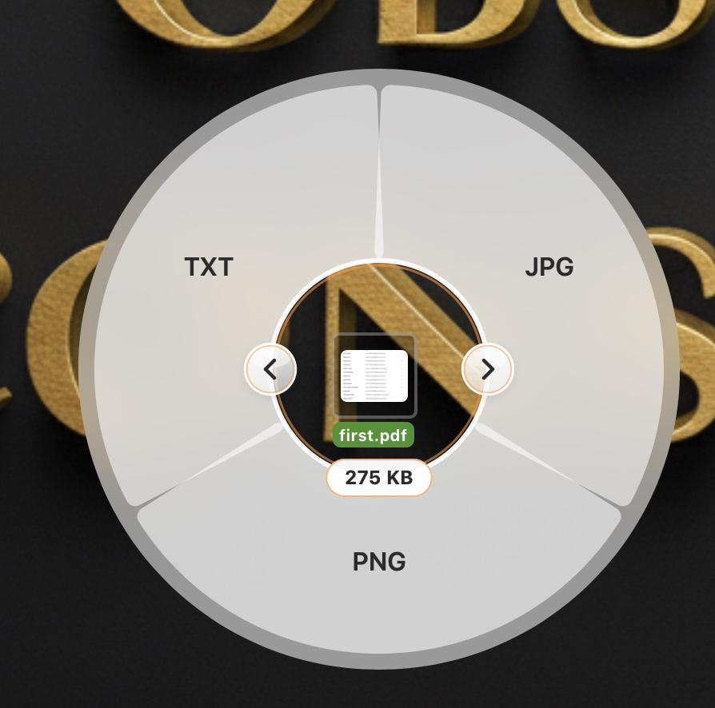
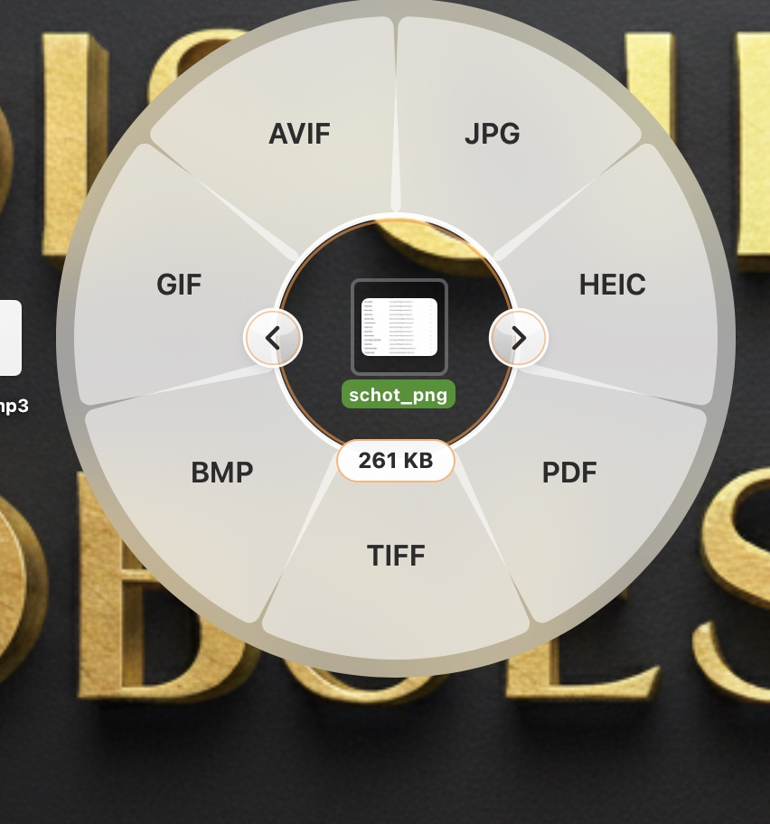

# Orbitron

**A free file converter and compressor for macOS, controlled by a radial wheel.**

Select a file in Finder, hold a key, and a wheel of options opens around your cursor. Hover a format, click it, and the converted copy is saved next to the original.




Orbitron is inspired by [Tangerine](https://www.tangerineformac.com), a paid app with a similar interaction. Orbitron is an independent project written from scratch and is not affiliated with it.

## Highlights

- **Convert (⇧ Shift):** images, PDF, Word/RTF/HTML/Markdown, spreadsheets, CSV/JSON, subtitles, audio and video
- **Tools (⌘ Command):** compress to a target size in KB or MB, resize, strip metadata, merge/split PDFs, zip and extract archives, plus a waveform audio editor (trim, mono/stereo levels, bleep)
- **Actions (⌃ Control):** reveal in Finder, copy path, AirDrop, copy or move to a folder, open in Terminal, floating file shelf
- **Private:** everything runs on your Mac. No accounts, no uploads, no tracking
- **Safe:** originals are never modified, output is validated before it appears, and existing files are never overwritten
- **Native:** Swift, SwiftUI and AppKit, with Liquid Glass on macOS 26 and frosted glass on earlier versions

## Why this exists

Converting a file usually means a web upload, a command line, or a paid app. Orbitron puts the common conversions one hover and one click away, and the code is here for anyone to read, extend, or add formats to.

## Build and run

Requires macOS 13+ and the Xcode command line tools (`xcode-select --install`).

```bash
git clone <your-repo-url>
cd Orbitron
chmod +x build.sh
./build.sh
```

This builds `build/Orbitron.app`, ad-hoc signs it and opens it. If Gatekeeper complains the first time, right-click the app → Open. To keep it, drag it to `/Applications`.

Optional engines:

```bash
brew install ffmpeg                    # audio + video conversion and tools
brew install --cask libreoffice        # Office → PDF, XLSX ↔ CSV
```

Orbitron hides any option whose engine isn't installed. Settings → Engines shows what it found.

## Using it

**Select and hold (main way):** click a file in Finder or on the Desktop, then hold Shift (Convert), Command (Tools) or Control (Actions) for about a third of a second. The wheel opens around the cursor with a clear ring in the middle, so the file you selected stays visible inside it, and a badge on the ring shows its size (it adds the option you hover, e.g. 2.2 MB → JPG). Hover a petal to highlight it, click to run it. Esc or a click elsewhere dismisses; pressing another wheel key switches wheels. The first time, macOS asks to let Orbitron control Finder: click OK (Privacy & Security → Automation).

**Drag:** holding the key while dragging a file also opens the wheel, and you drop on a petal.

| While dragging a file from Finder, hold | Wheel |
|---|---|
| ⇧ Shift | Convert |
| ⌘ Command | Tools (compress, resize, merge, split, extract…) |
| ⌃ Control | Actions (Reveal, Copy path, Float, AirDrop, Copy/Move to…, Terminal) |

Keys are configurable in Settings. The wheel opens under the cursor and stays after you release the key. Dropping on a segment runs it; hovering never does. Release anywhere else to cancel.

**Fallback:** the Drop Zone window (menu bar icon → Open Drop Zone) has three tiles. Drop files on one, or click it to browse, then click a segment on the wheel that appears. Esc dismisses, Tab or clicking the centre switches wheel.

Results are written to a hidden temp file, validated, then moved into place as `name.ext`, or `name_1.ext` if that exists. Originals are never touched or overwritten.

## What converts

| Input | Output | Engine |
|---|---|---|
| JPG PNG HEIC TIFF BMP GIF WebP AVIF | JPG PNG HEIC TIFF BMP GIF PDF | ImageIO / PDFKit |
| same images | WebP, AVIF | ffmpeg, only if your build has the encoder |
| SVG | PNG JPG PDF | macOS rendering (needs a macOS version that can draw SVG) |
| PDF | PNG JPG TXT (OCR for scans) | PDFKit / Vision |
| DOCX DOC RTF RTFD ODT HTML TXT | TXT HTML RTF DOCX | `textutil` |
| DOCX DOC RTF ODT HTML TXT MD | PDF | built-in layout (LibreOffice if installed) |
| Markdown | HTML DOCX RTF TXT PDF | built in |
| XLSX | CSV | built in |
| CSV TSV | XLSX | built in |
| CSV ↔ TSV, CSV/TSV ↔ JSON | | built in |
| XLS ODS PPTX PPT ODP | PDF / CSV / XLSX | LibreOffice (optional) |
| SRT ↔ VTT, either → TXT | | built in |
| MP4 MOV MKV WebM AVI WMV M4V | MP4 MOV MKV WebM GIF, audio formats | ffmpeg |
| MP3 M4A WAV FLAC OGG Opus AIFF WMA AAC | MP3 M4A WAV FLAC OGG Opus AIFF | ffmpeg |
| GIF | MP4 | ffmpeg |

**Compress to a size you choose:** select an image, PDF, video or audio file, hold Command and click Compress. A Liquid Glass panel (real Liquid Glass on macOS 26, frosted glass on earlier versions) lets you drag a slider, tap a preset (75 / 50 / 25 / 10 %), or type an exact target in KB or MB. Images lower JPEG quality first and then pixel size, video and audio pick a bitrate from the length and target size, and PDFs use Ghostscript when installed (`brew install ghostscript`, keeps text selectable) or rebuild pages as images. If a target is impossible it tells you the smallest size it can reach. Select several files and the slider sets a percentage for each. Any file or folder can also be compressed with Zip, tar.gz or Gzip.

Tools: half size / strip metadata / read QR / view metadata / combine to one PDF; PDF merge / split; video compress / mute / snapshot; audio normalize; zip, tar.gz, gzip, zip together, and safe extract of zip / tar / tgz / gz.

**Audio editors (Tools wheel, one audio file selected, needs ffmpeg):** Trim (drag the ends on the waveform, optional auto-trim of silent ends, play the selected range), Channels (mono or stereo with left/right levels, play the result before saving) and Bleep (drag across the waveform to cover sections with a tone, preview, save). Each saves a new file beside the original.

## Not built (yet)

- PDF → DOCX / PPTX / XLSX, Pages, EPUB, RAR
- Image and video editors: crop, annotate, redact, trim, speed, split/join, PDF page reordering, collage
- Per-conversion options window (quality is one global slider in Settings)
- Notifications; progress is shown in the Jobs window instead
- Animated GIF input converts only the first frame as an image (use the video routes for GIF → MP4)

## Caveats

- The Finder-drag interception reads the system drag pasteboard and polls modifier keys. It needs mouse monitoring only, no Accessibility permission. Behaviour can differ between macOS versions and with Stage Manager or full-screen spaces, so use the Drop Zone if the wheel doesn't appear.
- Menu-bar apps have no Dock icon. Quit from the menu bar icon.

## Layout

```
Sources/Orbitron/
  OrbitronApp.swift      app entry, menu bar item, drop zone, window hub
  DragCoordinator.swift  detects drags and held modifier keys
  Finder.swift           reads the Finder selection
  Wheel.swift            radial view, animation, panel, controller
  Registry.swift         which conversions, tools and actions exist for a selection
  Engines.swift          ImageIO, PDFKit, Vision, ffmpeg, textutil, archives
  Extra.swift            Markdown, document to PDF, XLSX, JSON, SVG
  Compress.swift         compress to a target size
  CompressPanel.swift    the Liquid Glass compress panel
  Editors.swift          audio editors: trim, channels, bleep
  Output.swift           naming, temp files, validation
  Jobs.swift             queue, cancellation, Jobs window
  Settings.swift         settings window, float shelf
  Model.swift            shared types and preferences
```

## Contributing

Issues and pull requests are welcome. Adding a conversion usually means one route in `Registry.swift` and one function in `Engines.swift` or `Extra.swift`.

Orbitron is not affiliated with Tangerine.
